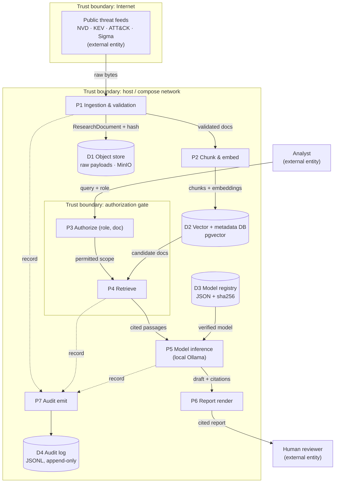

# Data-Flow Diagram

> **Scope: PUBLIC / synthetic data only.** This repository runs in the PUBLIC lane; see
> [trust-boundaries.md](trust-boundaries.md).

This is the data-flow diagram (DFD) for the three flows the platform cares about —
**ingestion**, **retrieval-augmented answering (RAG)**, and **audit** — with trust
boundaries drawn as subgraphs. It is the basis for the STRIDE analysis in
[threat-model.md](threat-model.md): STRIDE is applied at each boundary crossing below.

> **Phase 1 note.** The ingestion and RAG processes are documented **stubs** today
> (they raise `NotImplementedError` with a roadmap pointer). The audit emitter, the
> document schema, the model-integrity verifier, and the API skeleton are real. The DFD
> shows the intended Phase-2 flow so the boundaries can be reviewed before the code
> lands.

## Diagram

## External entities

| ID | Entity | Role in the flow |
|----|--------|------------------|
| — | **Analyst** | Submits a question and a role; receives a cited report. Untrusted input source. |
| — | **Public threat feeds** | NVD, CISA KEV, MITRE ATT&CK, Sigma. Untrusted external data crossing the internet boundary. |
| — | **Human reviewer** | Reviews and accepts/rejects the AI-drafted conclusion. The accountability backstop. |

## Processes

| ID | Process | Security-relevant job | Code |
|----|---------|----------------------|------|
| P1 | Ingestion & validation | Validate each item into a `PUBLIC` `ResearchDocument`; attach a `sha256:` content hash. | `ingestion/*` |
| P2 | Chunk & embed | Split text preserving citation boundaries; embed locally. | `retrieval/chunking.py`, `retrieval/embeddings.py` |
| P3 | Authorize | Decide, **before** retrieval, which documents the role may see. | `retrieval/authz.py` |
| P4 | Retrieve | Nearest-neighbor search within the authorized scope only. | `retrieval/vectorstore.py` |
| P5 | Model inference | Draft an answer constrained to retrieved passages, on a hash-verified local model. | `ai_security/model_integrity/`, Ollama |
| P6 | Report render | Emit a report where every claim cites a retrieved document id; drop uncited claims. | `reporting/report.py` |
| P7 | Audit emit | Append a reconstructable record of the analysis. | `audit/record.py` (real) |

## Data stores

| ID | Store | Contents | Notes |
|----|-------|----------|-------|
| D1 | Object store (MinIO) | Raw source payloads | Keyed by content hash; never user-writable directly. |
| D2 | Vector + metadata DB (pgvector) | Documents, chunks, embeddings, classification | Query path is authorization-filtered. |
| D3 | Model registry | Approved models + pinned `sha256` | No weights in the repo; one synthetic entry ships. |
| D4 | Audit log | Append-only JSON Lines | `research/audit` records; integrity matters more than confidentiality here. |

## Boundary crossings to analyze (STRIDE)

1. **feeds → P1 (internet → host):** untrusted external data. *Spoofing / Tampering* —
   verify source TLS and pin content hashes; treat all input as hostile.
2. **analyst → P3 (user → authorization gate):** untrusted query + asserted role.
   *Spoofing / Elevation of privilege* — authenticate the role; never trust a
   self-asserted header in production.
3. **P3 → P4 (authorization gate):** the confidentiality boundary. *Information
   disclosure* — a bug here leaks documents into the model's context.
4. **P5 model inference:** *Tampering* (model swap) — the integrity verifier pins the
   model hash. *Information disclosure* (prompt injection via retrieved text) — evaluate
   in Layer 6.
5. **P6 → reviewer (machine → human):** *Repudiation* — the audit record (P7 → D4) is
   what makes the analysis non-repudiable and reviewable.

Each crossing is enumerated with its STRIDE threats and mitigations in
[threat-model.md](threat-model.md).
