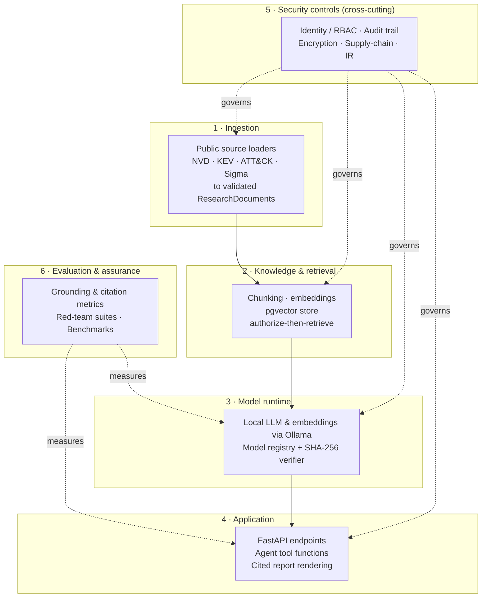

# System Design

> **Scope: PUBLIC / synthetic data only.** This repository is a learning-and-research
> scaffold. It is **not** approved for CUI or classified information and makes no claim
> of ATO or CMMC compliance. The trust-boundary model in
> [trust-boundaries.md](trust-boundaries.md) describes how the architecture *would*
> separate higher classifications if deployed there; this repo operates entirely in
> the PUBLIC lane.

The platform is an **evidence-grounded AI research assistant** for cybersecurity:
it ingests public threat knowledge (CVEs, exploited-vulnerability catalogs, ATT&CK,
detections), retrieves the passages relevant to an analyst's question, and uses a
**locally hosted** model to draft an answer in which **every claim cites a retrieved
source**. The security of the system — not just the content it reasons about — is a
first-class design concern.

## Guiding principles

Four principles constrain every layer below. They come from the roadmap (§1, §7)
and are the reason the architecture looks the way it does.

1. **Confidentiality** — data and credentials never cross a trust boundary they were
   not cleared for. Authorization is enforced *before* retrieval, so the model never
   receives a document the caller may not see.
2. **Integrity** — inputs are validated and provenance-tracked. Documents carry a
   `sha256:` content hash; models are verified against a pinned hash before use;
   dependencies are pinned and scanned.
3. **Auditability** — every AI-assisted analysis emits an append-only record (who,
   which model and prompt version, which sources, what conclusion) so the work can be
   reconstructed and reviewed.
4. **Human accountability** — the model drafts; a person decides. The model may
   *request* a tool call, but the application independently decides whether it is
   permitted. Uncited claims are omitted, never presented as fact.

## The six layers

| # | Layer | What it does | Code (Phase 1) |
|---|-------|--------------|----------------|
| 1 | **Ingestion** | Pull public sources and validate each item into a typed `ResearchDocument` with a content hash and `PUBLIC` classification. | `ingestion/schema.py` (real) · `ingestion/{nvd,kev,attack,sigma}.py` (stubs) |
| 2 | **Knowledge & retrieval** | Chunk, embed, store vectors in Postgres/pgvector, and return only the documents the caller's role may access. | `retrieval/{chunking,embeddings,vectorstore,authz}.py` (stubs) |
| 3 | **Model runtime** | Host embedding/generation models locally (Ollama); keep a registry of approved models and verify their integrity before use. | `ai_security/model_integrity/verify_model.py` (real) · model registry (real) |
| 4 | **Application** | Expose the API, mediate agent tool calls (permission checks outside the model), and render cited reports. | `api/` (real skeleton) · `agents/functions.py`, `reporting/report.py` (stubs) |
| 5 | **Security controls** | Cross-cutting: identity/RBAC, append-only audit, encryption-in-transit/at-rest guidance, supply-chain (SBOM, pinning, secret scanning), incident response. | `audit/` (real) · `security-controls/*`, `infrastructure/identity/` (docs) |
| 6 | **Evaluation & assurance** | Measure grounding, citation accuracy, refusal behavior, and resistance to prompt injection / information disclosure. | `evaluation/metrics.py` (stub) · `evaluation/` benchmarks (docs) |

Layers 1–4 form the request path (ingest → retrieve → reason → answer). Layer 5 is
**cross-cutting**: every layer runs under its controls. Layer 6 **measures** the
output of the model-runtime and application layers and feeds fixes back.

> **Phase 1 reality.** Only the items marked *real* above are implemented. Every stub
> raises `NotImplementedError` naming the roadmap phase that builds it — the pipeline's
> *shape* and its security wiring are reviewable before any retrieval or inference code
> lands. See [../ROADMAP.md](../ROADMAP.md) for the phase schedule.

## Technology choices

| Concern | Choice | Why |
|---------|--------|-----|
| Language / runtime | **Python 3.12** | Ecosystem for ML + security tooling; modern typing. |
| API | **FastAPI** + Uvicorn | Typed request/response, OpenAPI for free, async. |
| Data modeling / validation | **Pydantic v2** + pydantic-settings | Validation at the boundary; typed settings from env. |
| Relational + vector store | **Postgres 16 + pgvector** | One store for metadata *and* embeddings; mature, auditable. |
| Object storage | **MinIO** | S3-compatible local store for raw source payloads. |
| Model runtime | **Ollama** (local) | Keeps prompts and data on-host; no third-party inference. |
| Identity (Phase 5) | **Keycloak** (optional profile) | Standard OIDC/RBAC; Phase 1 uses a header role stub. |
| Telemetry (optional) | **OpenTelemetry Collector** | Vendor-neutral traces/metrics/logs (monitoring profile). |
| Packaging / lock | **pip-tools** compiled `requirements.txt` | One pinned source of truth for CI, pip-audit, SBOM, Dependabot. |
| Quality gates | **ruff · black · mypy · pytest** | Lint, format, type, test — enforced in CI and pre-commit. |
| Supply chain | **CycloneDX SBOM · pip-audit · gitleaks** | Inventory, known-vuln scan, secret scanning. |
| Orchestration | **Docker Compose** + devcontainer | Reproducible from a bare machine with only Docker + Python. |

## Model-selection strategy

The roadmap treats model choice as a **security and provenance** decision, not only a
quality one:

- **Local-first.** Embedding and generation run through a local Ollama runtime so that
  source text and prompts never leave the host. This is what makes the confidentiality
  principle enforceable end-to-end.
- **Right model per task.** A small, fast **embedding** model (default
  `nomic-embed-text`) indexes the corpus; a larger **generation** model drafts answers.
  Both are named in configuration, not hard-coded.
- **Registry + integrity.** Every approved model is an entry in
  `infrastructure/model-runtime/model-registry.json` with its publisher, license,
  source, format, approval status, and a pinned `sha256`. Before a model is used, its
  file hash is checked against the registry
  ([`verify_model.py`](../src/secure_ai_research/ai_security/model_integrity/verify_model.py));
  a missing or mismatched hash **fails loudly**. No weights are committed to the repo —
  the registry ships one clearly-labeled **synthetic** entry so `/version` and the
  verifier work with nothing on disk.
- **Swappable.** Because models are configuration + registry entries, upgrading a model
  is a reviewed change to the registry (new hash, new approval), not a code rewrite.

## Request path (Phase 2 target)

The intended end-to-end flow, once retrieval lands, is detailed in
[data-flow.md](data-flow.md). In brief: an authenticated request carries a role → the
authorization gate filters the corpus to what that role may see → retrieval returns
cited passages → the local model drafts an answer constrained to those passages → an
audit record is emitted → a cited report is returned for human review.
