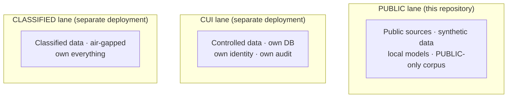
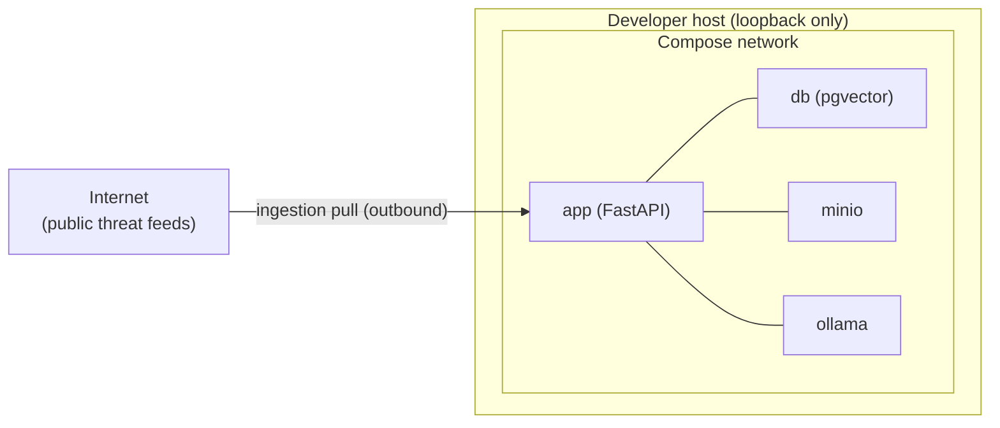
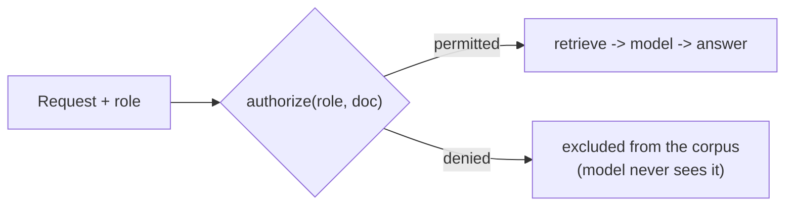

# Trust Boundaries

> **Scope: PUBLIC / synthetic data only.** This repository runs entirely in the PUBLIC
> lane. The CUI and Classified lanes below are documented so the separation model is
> explicit *if* the platform is ever deployed into a higher-classification environment —
> this repo is **not** approved for, and must never hold, CUI or classified data.

A trust boundary is a line where the level of trust changes and therefore data,
credentials, or control must be checked, transformed, or stopped. This document names
the boundaries the architecture assumes and states, for each, **what must never cross
it**.

## 1. Classification lanes (the outer boundary)

The platform is designed to run as **separate, non-communicating deployments per
classification level** — never as one deployment that mixes levels behind application
logic.

**What must never cross a lane boundary:**

- **Data** — neither upward (public → CUI is pointless and risks contamination of a
  clean corpus) nor, above all, **downward** (CUI/classified → public is a spill).
- **Credentials and identities** — each lane has its own identity provider, service
  accounts, and keys. A credential from one lane is never valid in another.
- **Infrastructure** — **no shared database, no shared API endpoint, no shared object
  store, no shared message bus.** Shared infrastructure is a shared blast radius.
- **Models and prompts** — a model or prompt template approved in one lane is
  re-reviewed before use in another; a model that saw controlled data is not moved to a
  lower lane.

### De-identification is not declassification

**Removing names, hostnames, or obvious identifiers from controlled data does not make
it public.** Classification is a property of the information and its origin, not of
whether a particular field is blanked out. Re-identification from "sanitized" data is a
well-known failure. In this platform that rule has teeth:

- Classification is pinned at the document boundary (`ingestion/schema.py` accepts
  **`PUBLIC` only**; any other value is rejected at validation, never stored).
- There is no code path that "downgrades" a document's classification by editing fields.
- Moving data to a lower lane is an out-of-band, human-authorized declassification
  decision — never something the pipeline does.

## 2. The network boundary (local dev)

- Inter-service traffic (app ↔ db / minio / ollama) stays on the **compose network**.
- Every published port is bound to **127.0.0.1** (see `docker-compose.yml`): services
  are reachable from the host for development, never from the LAN.
- The only outbound crossing is **ingestion pulling public feeds**; nothing inbound from
  the internet is accepted by default.

## 3. The authorization boundary (inside the application)

Even within the PUBLIC lane, not every role may see every document. The boundary that
enforces this sits **before retrieval**:

- **Authorization is applied before retrieval, never after generation.** The model only
  ever receives documents the caller is allowed to see, so there is nothing sensitive to
  leak in the generated answer. Filtering *after* generation would be a control that has
  already failed. (Enforced by `retrieval/authz.py` + `retrieval/vectorstore.retrieve`.)
- Phase 1 uses a simple **header role stub** (`X-Role: research_analyst`); Keycloak/OIDC
  is the Phase 5 target (optional `identity` compose profile). The *boundary* is the same
  either way — only the identity source changes.
- Roles are enumerated in `infrastructure/identity/roles.md`.

## 4. The human-accountability boundary

The last boundary is between **machine draft** and **accepted conclusion**:

- The model may *request* a tool call; the application independently decides whether it
  is permitted (`agents/functions.py` — checks live outside the LLM).
- Every AI-assisted analysis emits an append-only audit record (`audit/record.py`) so a
  human reviewer can reconstruct and sign off on it.
- An uncited claim is omitted from a report, never shown as established fact.

## Summary

| Boundary | Enforced by | Must never cross |
|----------|-------------|------------------|
| Classification lane | Separate deployments; `PUBLIC`-only validation | Data, credentials, infrastructure, models |
| Network | Loopback-bound ports; compose network | Unsolicited inbound; LAN exposure |
| Authorization | `authz.authorize` before retrieval | A document a role may not see reaching the model |
| Human accountability | Audit record; permission checks outside the LLM | An unreviewed, uncited conclusion leaving the system |

See [data-flow.md](data-flow.md) for where these boundaries sit on the data-flow
diagram, and [threat-model.md](threat-model.md) for the STRIDE analysis that crosses
each one.
